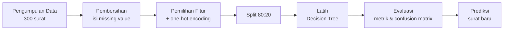
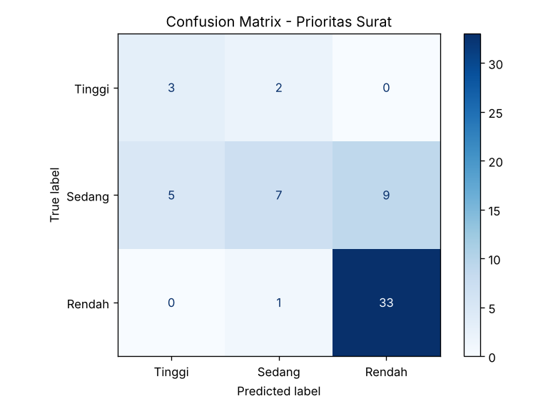
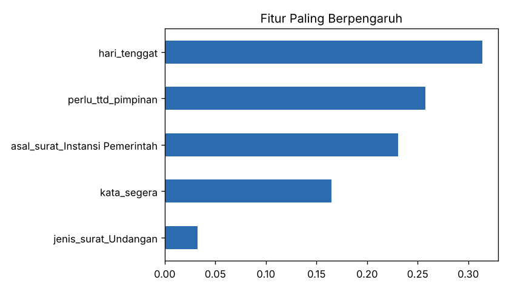
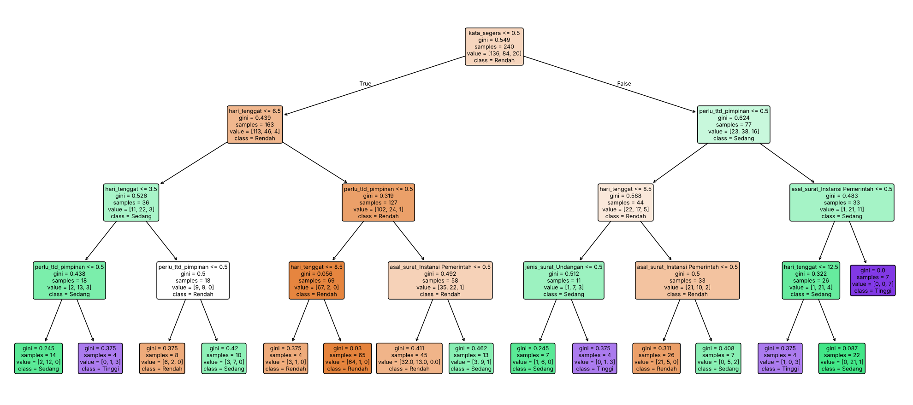

<div align="center">

# 📬 Klasifikasi Prioritas Surat Masuk Kantor
### Studi Kasus Supervised Learning dengan Decision Tree


---

### 👤 Identitas Penyusun
**Nama:** Kenia Nurma Feblia  
**NPM:** G1A023004  
**Universitas:** Universitas Bengkulu  

---

*Tugas resume & implementasi **Sesi 4: Introduction to Machine Learning**  
oleh Taniza Tajuddin (Universiti Teknologi MARA, Cawangan Kedah), 15 Oktober 2026*

</div>

---

## 📑 Daftar Isi
1. [Latar Belakang](#-latar-belakang)
2. [Rumusan Masalah](#-rumusan-masalah)
3. [Batasan Masalah](#-batasan-masalah)
4. [Tujuan](#-tujuan)
5. [Kaitan dengan Materi](#-kaitan-dengan-materi)
6. [Dataset](#-dataset)
7. [Alur Kerja](#-alur-kerja)
8. [Cara Menjalankan](#-cara-menjalankan)
9. [Hasil & Pembahasan](#-hasil--pembahasan)
10. [Kesimpulan](#-kesimpulan)
11. [Struktur Folder](#-struktur-folder)

---

## 🧭 Latar Belakang

Bagian tata usaha di sebuah kantor setiap hari menerima banyak surat masuk, seperti undangan, permohonan, edaran, dan laporan. Penentuan surat mana yang harus diproses lebih dahulu biasanya dilakukan secara manual berdasarkan pengalaman staf. Cara ini rawan terlambat, tidak konsisten antarstaf, dan semakin berat ketika jumlah surat bertambah.

Materi Sesi 4 menjelaskan bahwa *machine learning* memungkinkan komputer **mempelajari pola dari data** tanpa harus menulis seluruh aturan secara manual. Studi kasus ini menerapkan konsep tersebut untuk membantu **memprediksi tingkat prioritas surat masuk** (Tinggi / Sedang / Rendah) dari ciri-ciri surat.

## ❓ Rumusan Masalah

1. Bagaimana menerapkan *supervised learning* (klasifikasi) untuk menentukan prioritas surat masuk?
2. Seberapa baik model Decision Tree memprediksi prioritas surat pada data yang belum pernah dilihat?
3. Ciri surat apa yang paling berpengaruh terhadap tingkat prioritas?

## 🚧 Batasan Masalah

| No | Batasan | Keterangan |
|:--:|---|---|
| 1 | **Data simulasi** | Dataset berisi 300 surat yang dibuat dengan skrip `generate_data.py`, bukan data asli instansi, untuk menjaga kerahasiaan dokumen. |
| 2 | **Fitur terbatas** | Hanya 6 fitur: jenis surat, asal surat, sisa hari tenggat, jumlah lampiran, kata "segera/penting", dan kebutuhan tanda tangan pimpinan. |
| 3 | **Tidak membaca isi surat** | Model tidak mengolah teks atau isi surat (bukan NLP). Fitur diasumsikan sudah dicatat staf saat agenda surat. |
| 4 | **Tiga kelas prioritas** | Label hanya terdiri atas Tinggi, Sedang, dan Rendah. |
| 5 | **Satu algoritma** | Hanya menggunakan **Decision Tree** karena hasilnya mudah dijelaskan kepada pengguna nonteknis. |
| 6 | **Pembagian data** | Rasio 80% data latih dan 20% data uji, sesuai contoh pada materi. |
| 7 | **Ruang lingkup** | Program berbasis terminal (skrip Python), tanpa antarmuka web atau integrasi ke sistem persuratan. |

## 🎯 Tujuan

- Mempraktikkan alur ML sesuai materi: data → pembersihan → fitur → pembagian → pelatihan → evaluasi → prediksi.
- Mengukur kinerja model dengan **accuracy, precision, recall, F1-score, dan confusion matrix**.
- Menunjukkan secara nyata gejala **overfitting** dan cara mengatasinya.

## 🔗 Kaitan dengan Materi

| Konsep di Materi Sesi 4 | Penerapan di Studi Kasus |
|---|---|
| ML belajar pola dari data, bukan aturan manual | Model mempelajari pola prioritas dari 240 contoh surat berlabel |
| **Supervised learning – classification** | Memprediksi kelas Tinggi / Sedang / Rendah |
| Pembersihan data & *missing value* | 30 nilai kosong diisi menggunakan **median** |
| Pemilihan fitur relevan | `id_surat` dibuang karena tidak bermakna bagi prediksi |
| Pembagian data 80 : 20 | `train_test_split(test_size=0.2, stratify=y)` |
| Evaluasi pada data yang belum dilihat | Pengujian dilakukan pada 60 surat data uji |
| Accuracy, precision, recall, F1, confusion matrix | Dicetak di terminal dan disimpan sebagai gambar |
| **Overfitting** | Membandingkan pohon tanpa batas dengan pohon `max_depth=4` |
| Tantangan kualitas data & bias | Dibahas melalui ketidakseimbangan kelas "Tinggi" |

## 🗂️ Dataset

File: `data/surat_masuk.csv` (300 baris)

| Kolom | Tipe | Keterangan |
|---|---|---|
| `id_surat` | teks | Nomor agenda surat (tidak dipakai sebagai fitur) |
| `jenis_surat` | kategori | Undangan, Permohonan, Pemberitahuan, Laporan, Edaran |
| `asal_surat` | kategori | Internal, Mitra, Instansi Pemerintah, Masyarakat |
| `hari_tenggat` | angka | Sisa hari menuju batas waktu (1–30) |
| `jumlah_lampiran` | angka | Banyaknya lampiran (0–5) |
| `kata_segera` | 0/1 | Perihal memuat kata "segera/penting" |
| `perlu_ttd_pimpinan` | 0/1 | Surat memerlukan tanda tangan pimpinan |
| **`prioritas`** | **label** | **Tinggi / Sedang / Rendah** (target) |

Sebaran label: **Rendah 170**, **Sedang 105**, **Tinggi 25**.

## 🔄 Alur Kerja



## ▶️ Cara Menjalankan

```bash
# 1. Clone repository
git clone https://github.com/keniafeblia/prioritas-surat-ml.git
cd prioritas-surat-ml

# 2. Install library
pip install -r requirements.txt

# 3. (Opsional) buat ulang dataset
python generate_data.py

# 4. Jalankan program utama
python main.py
```

Grafik hasil akan tersimpan otomatis di folder `output/`.

## 📊 Hasil & Pembahasan

### 1. Cek Overfitting

| Model | Akurasi Latih | Akurasi Uji |
|---|:--:|:--:|
| Decision Tree tanpa batas kedalaman | 0.99 | 0.67 |
| Decision Tree `max_depth=4` ✅ | 0.84 | **0.72** |

Pohon tanpa batas hampir sempurna pada data latih (99%), tetapi turun tajam pada data uji (67%). Kondisi ini merupakan contoh **overfitting** seperti yang dijelaskan dalam materi, yaitu model "menghafal" data latih. Setelah kedalaman dibatasi, selisih akurasi mengecil dan akurasi uji justru naik.

### 2. Evaluasi Model Akhir (data uji, 60 surat)

| Kelas | Precision | Recall | F1-score | Jumlah |
|---|:--:|:--:|:--:|:--:|
| Rendah | 0.79 | 0.97 | 0.87 | 34 |
| Sedang | 0.70 | 0.33 | 0.45 | 21 |
| Tinggi | 0.38 | 0.60 | 0.46 | 5 |
| **Accuracy** | | | **0.72** | 60 |

<p align="center">
  
</p>

**Pembahasan:**
- Kelas **Rendah** dikenali sangat baik (recall 97%) karena datanya paling banyak.
- Kelas **Tinggi** hanya memiliki 25 data, sehingga precision-nya rendah. Hal ini menggambarkan tantangan **ketidakseimbangan data (bias)** yang disebut dalam materi.
- Banyak surat **Sedang** tertebak sebagai Rendah. Bagi kantor, kesalahan ini lebih aman daripada kebalikannya, tetapi tetap perlu diperbaiki dengan menambah data.

### 3. Fitur Paling Berpengaruh

<p align="center">
  
</p>

Penentu utama prioritas secara berurutan adalah sisa **hari tenggat**, kebutuhan **tanda tangan pimpinan**, surat dari **Instansi Pemerintah**, dan kata **"segera"**. Hasil ini masuk akal karena sesuai dengan logika kerja staf tata usaha.

### 4. Pohon Keputusan

<p align="center">
  
</p>

### 5. Contoh Prediksi Surat Baru

| Surat | Prediksi |
|---|:--:|
| Undangan dari Instansi Pemerintah, tenggat 2 hari, ada kata "segera", perlu TTD | 🔴 **Tinggi** |
| Laporan dari Internal, tenggat 20 hari, tidak mendesak | 🟢 **Rendah** |

## ✅ Kesimpulan

1. *Supervised learning* dengan Decision Tree dapat membantu bagian tata usaha **memilah prioritas surat** secara otomatis dengan akurasi **72%** pada data uji.
2. Pembatasan kedalaman pohon terbukti **mengurangi overfitting**, dengan akurasi uji naik dari 67% menjadi 72%.
3. **Kualitas dan keseimbangan data** sangat menentukan hasil. Kelas Tinggi yang datanya sedikit menjadi kelas paling sulit diprediksi.
4. Model ini sebaiknya digunakan sebagai **alat bantu** keputusan staf, bukan pengganti, sesuai pesan materi bahwa AI perlu diterapkan secara cermat dan etis.

**Saran pengembangan:** menambah data surat asli, menyeimbangkan kelas, mencoba algoritma lain seperti Random Forest, dan membaca isi surat dengan teknik NLP.

## 📁 Struktur Folder

```
prioritas-surat-ml/
├── data/
│   └── surat_masuk.csv        # dataset simulasi 300 surat
├── output/
│   ├── confusion_matrix.png
│   ├── fitur_penting.png
│   └── pohon_keputusan.png
├── generate_data.py           # pembuat dataset
├── main.py                    # program utama ML
├── requirements.txt
├── .gitignore
└── README.md
```

---

<div align="center">

**Kenia Nurma Feblia** (NPM: G1A023004)  
**Universitas Bengkulu**

</div>
